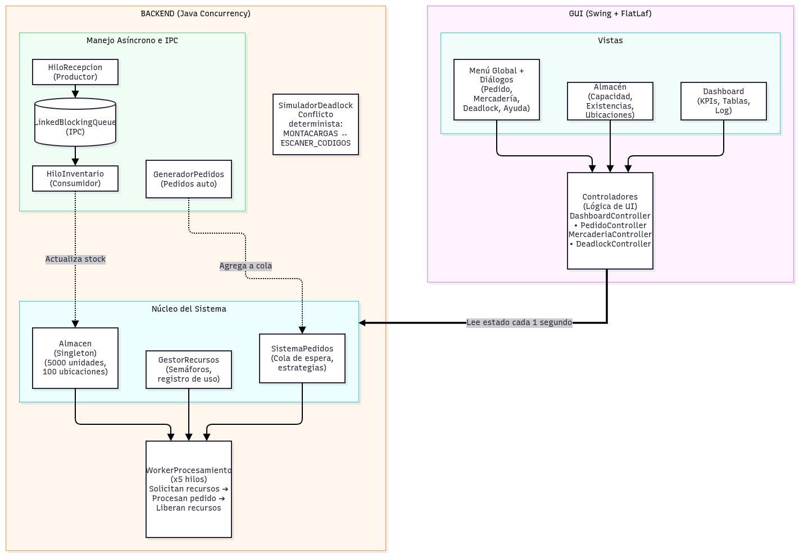
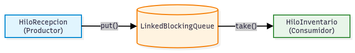
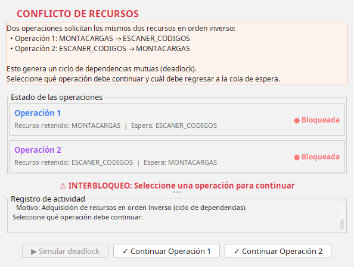
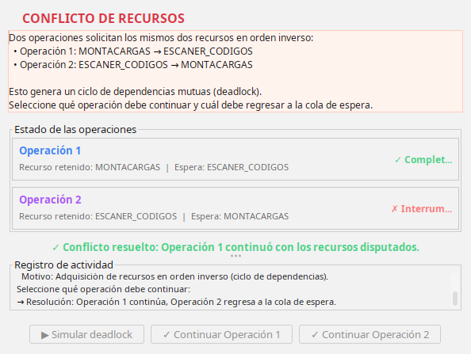
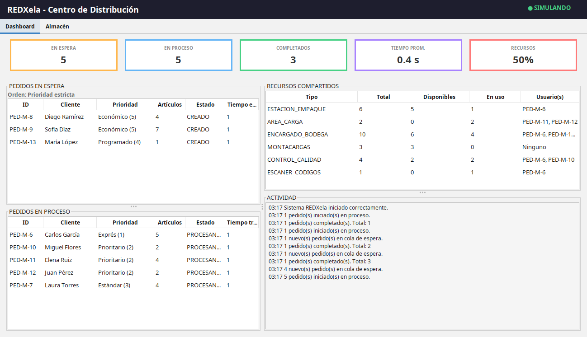
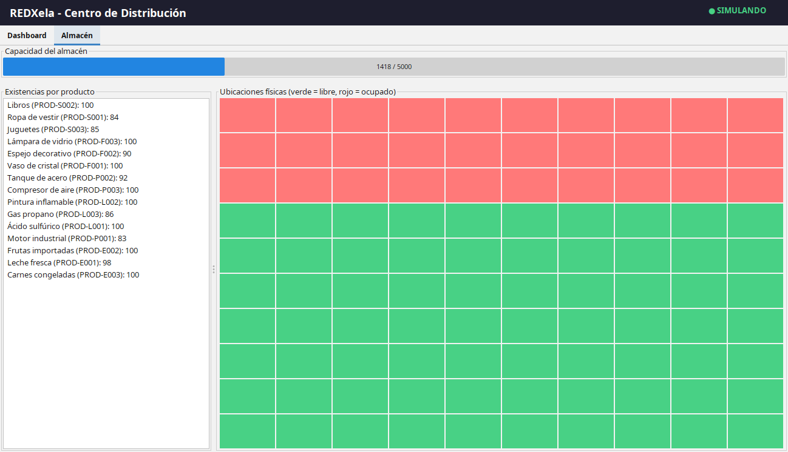

# Manual Técnico — REDXela

---

> **Universidad de San Carlos de Guatemala**  
> **Centro Universitario de Occidente**  
> **División de Ciencias de la Ingeniería**  
> **Ingeniería en Ciencias y Sistemas**  
> **Sistemas Operativos 2**  
> **Autor:** Juan Casiá  
> **Registro Académico:** 201930457  
> **Versión:** 1.0  
> **Fecha:** Octubre 2026  

---

**Centro de Distribución — Simulación de Sistemas Operativos**

---

## 1. Introducción

Este documento describe la infraestructura técnica del sistema REDXela, una aplicación Java que simula el funcionamiento interno de un centro de distribución de comercio electrónico. El proyecto aplica conceptos fundamentales de Sistemas Operativos: planificación de procesos, sincronización de hilos, exclusión mutua, semáforos, comunicación entre procesos (IPC), administración de almacenamiento y detección y resolución de deadlocks.

El objetivo de este manual es explicar los fundamentos teóricos detrás de cada decisión de diseño y cómo se implementaron en el código fuente.

---

## 2. Arquitectura General

### 2.1. Diagrama de Componentes



### 2.2. Tecnologías Utilizadas

| Tecnología               | Versión | Propósito                                      |
|--------------------------|---------|------------------------------------------------|
| **Java**                 | 21      | Lenguaje de programación principal             |
| **Maven**                | 3.x     | Gestión de dependencias y compilación          |
| **Swing**                | JDK 21  | Interfaz gráfica de escritorio                 |
| **FlatLaf**              | 3.5.4   | Look and Feel moderno para Swing               |
| **java.util.concurrent** | JDK 21  | Semáforos, locks, BlockingQueue, AtomicInteger |

---

## 3. Planificación de Procesos

### 3.1. Fundamento Teórico

La planificación de procesos es el mecanismo por el cual un sistema operativo decide qué proceso se ejecuta a continuación cuando múltiples procesos compiten por la CPU. En REDXela, los "procesos" son los pedidos y la "CPU" son los 5 trabajadores (workers) que los procesan concurrentemente.

Los algoritmos de planificación buscan optimizar métricas como:

- **Throughput**: Cantidad de pedidos completados por unidad de tiempo.
- **Tiempo de respuesta**: Tiempo desde que un pedido llega hasta que comienza a procesarse.
- **Tiempo de espera**: Tiempo total en la cola antes de ser atendido.
- **Equidad**: Que ningún pedido quede indefinidamente sin atender (starvation).

### 3.2. Implementación en REDXela

Se implementaron tres estrategias de planificación, cada una representando un algoritmo clásico:

#### 3.2.1. Prioridad Estricta (`EstrategiaPrioridadEstricta`)

**Algoritmo equivalente**: Priority Scheduling (planificación por prioridades).

Los pedidos se ordenan por nivel de servicio del cliente (1 = Exprés, 5 = Económico). El pedido con menor número de nivel se selecciona primero.

**Ventajas**:
- Los clientes con mayor nivel de servicio reciben atención preferencial.
- Predecible para clientes Exprés y Prioritarios.

**Desventajas**:
- Posible **starvation** de pedidos Económicos si llegan constantemente pedidos Exprés.
- No considera el tiempo de espera acumulado.

**Complejidad**: O(n) — recorre la cola completa buscando el pedido con menor nivel.

#### 3.2.2. Tiempo de Espera (`EstrategiaTiempoEspera`)

**Algoritmo equivalente**: FIFO (First In, First Out) / Round Robin sin quantum.

Los pedidos se procesan en el orden en que llegaron al sistema. El campo `tiempoLlegada` determina el orden.

**Ventajas**:
- Máxima equidad: ningún pedido queda indefinidamente sin atender.
- Simple y predecible.

**Desventajas**:
- Un pedido Exprés puede esperar mucho si llegó después de varios pedidos Económicos.
- No optimiza el throughput.

**Complejidad**: O(n) — recorre la cola buscando el pedido con menor `tiempoLlegada`.

#### 3.2.3. Menor Cantidad de Artículos (`EstrategiaMenorCantidad`)

**Algoritmo equivalente**: SJF (Shortest Job First).

Los pedidos con menos unidades totales se procesan primero, optimizando el throughput del sistema.

**Ventajas**:
- Maximiza la cantidad de pedidos completados por unidad de tiempo.
- Reduce el tiempo promedio de espera (teorema de SJF).

**Desventajas**:
- Pedidos grandes pueden sufrir starvation si llegan constantemente pedidos pequeños.
- No considera el nivel de servicio del cliente.

**Complejidad**: O(n) — recorre la cola buscando el pedido con menor `cantidadTotalArticulos`.

### 3.3. Cambio de Estrategia en Tiempo Real

La clase `SistemaPedidos` permite cambiar la estrategia activa dinámicamente mediante `setEstrategia(EstrategiaPlanificacion)`. El cambio se aplica inmediatamente en la siguiente selección de pedido, sin necesidad de reiniciar el sistema.

---

## 4. Sincronización y Exclusión Mutua

### 4.1. Fundamento Teórico

Cuando múltiples hilos acceden a recursos compartidos simultáneamente, se requiere **exclusión mutua** para garantizar que solo un hilo modifique el recurso a la vez. Sin sincronización, se producen **condiciones de carrera** (race conditions) que corrompen los datos.

Los mecanismos de sincronización utilizados en REDXela son:

- **Semáforos** (`java.util.concurrent.Semaphore`): Controlan el acceso a recursos con múltiples instancias.
- **Locks** (`java.util.concurrent.locks.ReentrantLock`): Exclusión mutua estricta para recursos únicos.
- **Bloqueos de monitor** (`synchronized`): Protección de secciones críticas en métodos y bloques.

### 4.2. Semáforos en GestorRecursos

La clase `GestorRecursos` gestiona 6 tipos de recursos compartidos, cada uno con un semáforo de tipo **fair** (justo):

| Recurso            | Semáforo              | Permisos |
|--------------------|-----------------------|----------|
| `ESTACION_EMPAQUE` | `Semaphore(6, true)`  | 6        |
| `AREA_CARGA`       | `Semaphore(2, true)`  | 2        |
| `ENCARGADO_BODEGA` | `Semaphore(10, true)` | 10       |
| `MONTACARGAS`      | `Semaphore(3, true)`  | 3        |
| `CONTROL_CALIDAD`  | `Semaphore(4, true)`  | 4        |
| `ESCANER_CODIGOS`  | `Semaphore(1, true)`  | 1        |

**¿Por qué semáforos fair?**

Un semáforo con `fairness = true` garantiza que los hilos que esperan sean atendidos en orden FIFO. Sin fairness, un hilo podría obtener el recurso repetidamente mientras otros esperan indefinidamente (injusticia del semáforo). En un centro de distribución, esto es crítico: un pedido Exprés no debería monopolizar un recurso mientras otros esperan.

**Método `solicitarRecurso()`**:

```java
public void solicitarRecurso(TipoRecurso tipo, String idOperacion)
        throws InterruptedException {
    Semaphore semaforo = semaforos.get(tipo);
    semaforo.acquire(); // Bloquea hasta obtener permiso
    registroUso.get(tipo).add(idOperacion);
}
```

El método `acquire()` es **bloqueante**: si no hay permisos disponibles, el hilo se suspende hasta que otro hilo libere el recurso con `release()`.

**Método `liberarRecurso()`**:

```java
public void liberarRecurso(TipoRecurso tipo, String idOperacion) {
    registroUso.get(tipo).remove(idOperacion);
    semaforos.get(tipo).release(); // Libera un permiso
}
```

### 4.3. Registro de Uso Múltiple

El campo `registroUso` es un `Map<TipoRecurso, List<String>>` que rastrea **todos** los usuarios activos de cada tipo de recurso, no solo uno. Esto permite que la GUI muestre exactamente qué pedidos están usando cada recurso en tiempo real.

---

## 5. Comunicación entre Procesos (IPC)

### 5.1. Fundamento Teórico

La comunicación entre procesos (Inter-Process Communication, IPC) es el mecanismo por el cual dos o más procesos intercambian datos. En sistemas operativos, los patrones comunes son:

- **Tuberías (pipes)**: Canal unidireccional de datos.
- **Colas de mensajes**: Estructura FIFO compartida.
- **Memoria compartida**: Región de memoria accesible por múltiples procesos.
- **Sockets**: Comunicación por red.

El patrón **Productor-Consumidor** es uno de los problemas clásicos de IPC: un proceso genera datos (productor) y otro los consume (consumidor). El desafío es manejar las diferencias de velocidad: si el productor genera más rápido que el consumidor, se necesita un búfer; si el consumidor es más rápido, no debe procesar datos inexistentes.

### 5.2. Implementación en REDXela

La comunicación entre **Recepción de Mercadería** (`HiloRecepcion`) y **Control de Inventario** (`HiloInventario`) se implementa con una `LinkedBlockingQueue<MensajeRecepcion>`:



**¿Por qué `LinkedBlockingQueue`?**

- Es **thread-safe**: no requiere sincronización externa.
- El método `put()` **bloquea** si la cola está llena, evitando que el productor sobrescriba datos.
- El método `take()` **bloquea** si la cola está vacía, evitando que el consumidor procese datos inexistentes.
- Implementa naturalmente el patrón Productor-Consumidor sin necesidad de semáforos adicionales.

**HiloRecepcion (Productor)**:

Genera mensajes de recepción de mercadería y los pone en la cola con `put()`. Si la cola está llena, el hilo se bloquea hasta que haya espacio.

**HiloInventario (Consumidor)**:

Toma mensajes de la cola con `take()` y actualiza el `Almacen`. Si la cola está vacía, el hilo se bloquea hasta que haya datos.

**Ventajas de este enfoque**:
- No hay pérdida de datos: la cola actúa como búfer.
- No hay bloqueo indefinido: los métodos bloqueantes resuelven la diferencia de velocidad.
- Las áreas no modifican directamente las estructuras de la otra: la comunicación es indirecta a través de la cola.

---

## 6. Administración de Almacenamiento

### 6.1. Fundamento Teórico

La administración de memoria en sistemas operativos implica asignar y liberar espacio de forma eficiente. Los algoritmos comunes son:

- **Contiguo**: Asigna bloques consecutivos. Simple pero genera fragmentación externa.
- **Paginado**: Divide la memoria en páginas fijas. Elimina fragmentación externa pero puede tener fragmentación interna.
- **Segmentado**: Asigna segmentos lógicos. Flexible pero complejo.

En REDXela, el almacén se modela como un sistema de almacenamiento con **100 ubicaciones físicas** que no necesariamente son contiguas, similar al algoritmo de asignación de memoria con fragmentación.

### 6.2. Implementación en Almacen

La clase `Almacen` (Singleton) gestiona:

- **Capacidad total**: 5000 unidades (`CAPACIDAD_MAXIMA`).
- **Espacio ocupado**: Contador atómico de unidades almacenadas.
- **Existencias por producto**: `ConcurrentHashMap<String, Integer>` para acceso concurrente seguro.
- **Ubicaciones físicas**: `boolean[100]` donde `true` = ocupada, `false` = libre.

**Asignación de ubicaciones**:

Al registrar la llegada de mercadería, se calculan las ubicaciones necesarias (cada 50 unidades ocupan 1 ubicación, mínimo 1 por lote) y se asignan buscando las primeras posiciones libres. Las ubicaciones no son contiguas: se asignan las primeras disponibles, lo que puede resultar en un lote distribuido en diferentes "pasillos".

**Métodos clave**:

| Método                         | Propósito                                                               |
|--------------------------------|-------------------------------------------------------------------------|
| `registrarLlegadaMercaderia()` | Aumenta el stock y asigna ubicaciones físicas.                          |
| `hayStockParaPedido()`         | Verifica si hay suficiente stock para todos los productos de un pedido. |
| `descontarStock()`             | Resta las unidades consumidas al procesar un pedido.                    |
| `asignarUbicaciones()`         | Busca y marca las ubicaciones libres necesarias.                        |
| `liberarUbicaciones()`         | Libera las primeras ubicaciones ocupadas (método auxiliar no invocado actualmente por el flujo de despacho). |

**Thread safety**: Los métodos que modifican el estado del almacén son `synchronized` para evitar condiciones de carrera entre los workers y los hilos de inventario.

---

## 7. Deadlock (Interbloqueo)

### 7.1. Fundamento Teórico

Un **deadlock** (interbloqueo) ocurre cuando dos o más procesos quedan bloqueados indefinidamente porque cada uno espera un recurso que posee otro. Para que un deadlock ocurra, deben cumplirse simultáneamente las **cuatro condiciones de Coffman**:

1. **Exclusión mutua**: Un recurso solo puede ser usado por un proceso a la vez.
2. **Retención y espera**: Un proceso retiene al menos un recurso mientras espera otro.
3. **No apropiación**: Los recursos no pueden ser confiscados; solo se liberan voluntariamente.
4. **Espera circular**: Existe un ciclo de dependencias entre procesos y recursos.

**Gráfico de asignación de recursos**:

```
Proceso 1 ──solicita──> Recurso B (poseído por Proceso 2)
Proceso 2 ──solicita──> Recurso A (poseído por Proceso 1)
```

### 7.2. Estrategias de Manejo de Deadlocks

Los sistemas operativos manejan los deadlocks con cuatro estrategias:

| Estrategia                   | Descripción                                                                  | Uso en REDXela                                                        |
|------------------------------|------------------------------------------------------------------------------|-----------------------------------------------------------------------|
| **Ignorar**                  | Se asume que los deadlocks son raros (algoritmo del avestruz).               | No aplicada                                                           |
| **Prevención**               | Se rompe al menos una de las 4 condiciones de Coffman.                       | Parcial: los recursos se solicitan en orden alfabético en los workers |
| **Detección y recuperación** | Se permite el deadlock, se detecta y se resuelve.                            | **Sí**: SimuladorDeadlock                                             |
| **Evitación**                | Se analiza el estado antes de asignar recursos (Algoritmo del Banquero).     | No aplicada                                                           |

### 7.3. Simulación de Deadlock en REDXela

La clase `SimuladorDeadlock` crea deliberadamente un deadlock determinista usando `ReentrantLock`:

**Escenario**:

```
Operación 1: Adquiere MONTACARGAS → Espera ESCANER_CODIGOS (bloqueado)
Operación 2: Adquiere ESCANER_CODIGOS → Espera MONTACARGAS (bloqueado)
```



**¿Por qué ReentrantLock en lugar de los semáforos de GestorRecursos?**

Los semáforos de `GestorRecursos` tienen múltiples permisos (3 montacargas, 1 escáner). Con 3 montacargas, la probabilidad de que ambas operaciones queden bloqueadas es baja porque una podría obtener un montacargas diferente. Con `ReentrantLock` (permiso único), el deadlock es **determinista**: siempre ocurre.

**Detección automática**:

Un hilo detector verifica periódicamente que ambas operaciones estén bloqueadas mutuamente. Cuando se confirma el deadlock, se notifica al `DeadlockListener` (el diálogo de la GUI) para mostrar el conflicto al usuario.

**Resolución manual**:

El usuario elige qué operación continúa. La operación seleccionada obtiene los recursos disputados y la otra se interrumpe (`Thread.interrupt()`), liberando su lock y rompiendo el ciclo de bloqueo.



---

## 8. Niveles de Servicio y Clientes

### 8.1. Modelo de Clientes

Cada cliente se registra en el sistema con un **nivel de servicio contratado** que determina la prioridad de todos sus pedidos. El nivel de servicio pertenece al cliente, no al pedido individual.

**Clase `Cliente`**:

- **ID único**: Generado secuencialmente (CLT-0001, CLT-0002, ...).
- **Nombre**: Identificador legible del cliente.
- **Nivel de servicio**: Entero de 1 a 5, contratado al registrarse.

**Clase `GestorClientes`** (Singleton):

- Gestiona el registro de clientes.
- Evita duplicados por nombre: si un cliente ya existe, se retorna el registro existente.
- Permite búsqueda por nombre o ID.

### 8.2. Niveles de Servicio

| Nivel | Nombre          | Tiempo máximo de espera | Descripción                    |
|-------|-----------------|-------------------------|--------------------------------|
| 1     | **Exprés**      | 60 segundos             | Procesamiento casi instantáneo |
| 2     | **Prioritario** | 10 minutos              | Atención preferencial          |
| 3     | **Estándar**    | 30 minutos              | Servicio normal                |
| 4     | **Programado**  | 60 minutos              | Atención programada            |
| 5     | **Económico**   | 120 minutos             | Servicio básico, menor costo   |

---

## 9. Tipos de Mercancía

### 9.1. Clasificación

Cada producto pertenece a un tipo de mercancía que determina qué recursos necesita para su procesamiento. Esto permite que los workers soliciten los recursos correctos según el tipo de producto.

| Tipo           | Recursos requeridos           | Justificación                                 |
|----------------|-------------------------------|-----------------------------------------------|
| **Frágil**     | Empaque, Encargado, Calidad   | Requiere manipulación delicada y verificación |
| **Pesado**     | Montacargas, Carga, Encargado | Necesita equipo pesado y área de carga        |
| **Peligroso**  | Escáner, Encargado, Carga     | Requiere registro y área controlada           |
| **Perecedero** | Calidad, Escáner, Encargado   | Necesita verificación de frescura y registro  |
| **Estándar**   | Empaque, Encargado            | Procesamiento básico                          |

### 9.2. Condición de Contención

El enunciado requiere que exista al menos un escenario donde dos pedidos necesiten los mismos recursos compartidos. Esto se cumple porque:

- **Frágil** y **Perecedero** comparten `ENCARGADO_BODEGA`.
- **Pesado** y **Peligroso** comparten `AREA_CARGA`.
- **Peligroso** y **Perecedero** comparten `ESCANER_CODIGOS`.

Cuando dos workers procesan pedidos de tipos que comparten recursos, compiten por los mismos semáforos, demostrando la contención.

---

## 10. Interfaz Gráfica (GUI)

### 10.1. Arquitectura MVC

La GUI sigue un patrón **Modelo-Vista-Controlador** adaptado:

- **Modelo**: Las clases del backend (`SistemaPedidos`, `GestorRecursos`, `Almacen`) proporcionan los datos.
- **Vista**: Las clases Swing (`REDXelaMainFrame`, diálogos, tablas) renderizan la interfaz.
- **Controlador**: Las clases `*Controller` (`DashboardController`, `PedidoController`, etc.) encapsulan la lógica de negocio de la UI.



### 10.2. Actualización en Tiempo Real

Un `javax.swing.Timer` de 1000ms actualiza los paneles cada segundo. Las actualizaciones se ejecutan en el **EDT** (Event Dispatch Thread) de Swing para garantizar thread safety:

```java
Timer timer = new Timer(1000, e -> actualizarPaneles());
```

**¿Por qué `javax.swing.Timer` y no `Thread.sleep()`?**

El `Timer` de Swing ejecuta sus acciones automáticamente en el EDT, evitando la necesidad de `SwingUtilities.invokeLater()`. Un hilo manual con `sleep()` requeriría sincronización explícita con el EDT.

### 10.3. FlatLaf

Se utiliza `FlatLightLaf` (FlatLaf 3.5.4) como Look and Feel para reemplazar el diseño anticuado de Swing por defecto. FlatLaf proporciona:

- Diseño plano y moderno.
- Colores consistentes.
- Soporte para modo oscuro (no implementado en esta versión).
- Integración automática con componentes Swing nativos.

### 10.4. TableModels Personalizados

Cada tabla del Dashboard usa un `AbstractTableModel` personalizado que lee directamente del backend:

| TableModel             | Fuente de datos                           |
|------------------------|-------------------------------------------|
| `ModeloRecursos`       | `GestorRecursos.getRecursosDisponibles()` |
| `ModeloPedidosEspera`  | `SistemaPedidos.getColaEspera()`          |
| `ModeloPedidosProceso` | `SistemaPedidos.getPedidosProcesando()`   |

Cada segundo, `fireTableDataChanged()` notifica a las tablas que recarguen los datos.



---

## 11. Hilos del Sistema

### 11.1. Diagrama de Hilos

| Hilo                    | Cantidad | Propósito                                       |
|-------------------------|----------|-------------------------------------------------|
| **EDT (Swing)**         | 1        | Actualización de la interfaz gráfica            |
| **WorkerProcesamiento** | 5        | Procesamiento concurrente de pedidos            |
| **GeneradorPedidos**    | 1        | Generación automática de pedidos                |
| **HiloRecepcion**       | 1        | Producción de mensajes de mercadería            |
| **HiloInventario**      | 1        | Consumo de mensajes y actualización del almacén |
| **SimuladorDeadlock**   | 2+1      | Dos operaciones en conflicto + detector         |

### 11.2. WorkerProcesamiento

Cada worker sigue este ciclo:

1. **Obtener pedido**: Llama a `SistemaPedidos.obtenerSiguientePedido()` que aplica la estrategia activa.
2. **Verificar stock**: Si no hay suficiente inventario, el pedido se bloquea y el worker busca el siguiente.
3. **Solicitar recursos**: Determina los recursos necesarios según el tipo de mercancía de cada producto y los solicita en orden alfabético.
4. **Procesar**: Simula el trabajo con `Thread.sleep()` proporcional a la cantidad de artículos.
5. **Descontar stock**: Resta las unidades del almacén.
6. **Liberar recursos**: Libera los recursos en orden inverso.
7. **Completar**: Marca el pedido como completado y actualiza las estadísticas.

**Orden alfabético de recursos**:

Los recursos se solicitan en orden alfabético para reducir la probabilidad de deadlocks naturales. Al solicitar siempre en el mismo orden, se rompe la condición de **espera circular** de Coffman. Sin embargo, el `SimuladorDeadlock` usa `ReentrantLock` directamente para garantizar un deadlock determinista.

---

## 12. Compilación y Ejecución

### 12.1. Compilación

```bash
mvn compile
```

Compila los 36 archivos Java del proyecto sin errores.

### 12.2. Empaquetamiento

```bash
mvn package
```

Genera dos JARs en `target/`:

- `red-xela-1.0-SNAPSHOT.jar` (aprox. 1 MB): JAR ejecutable con todas las dependencias incluidas.
- `original-red-xela-1.0-SNAPSHOT.jar` (aprox. 85 KB): JAR original solo con el código del proyecto.

### 12.3. Ejecución

```bash
java -jar target/red-xela-1.0-SNAPSHOT.jar
```

Requiere Java 21 o superior. Al ejecutar, se abre la ventana principal y se inician todos los hilos del backend.

---

## 13. Estructura del Código Fuente

```
src/main/java/org/giov/
├── Main.java                          # Punto de entrada, inicialización del sistema
├── hilos/
│   ├── SistemaPedidos.java            # Cola de espera, estrategias, contadores
│   ├── WorkerProcesamiento.java       # Hilo de procesamiento de pedidos
│   ├── GeneradorPedidos.java          # Generación automática de pedidos
│   ├── HiloRecepcion.java             # Productor de mensajes de mercadería
│   ├── HiloInventario.java            # Consumidor de mensajes de mercadería
│   ├── SimuladorDeadlock.java         # Simulación determinista de deadlock
│   └── MensajeRecepcion.java          # Record para IPC
├── modelo/
│   ├── Pedido.java                    # Estructura de datos del pedido
│   ├── Cliente.java                   # Cliente con ID, nombre y nivel de servicio
│   ├── GestorClientes.java            # Singleton: registro de clientes
│   ├── TipoMercancia.java             # Tipo de mercancía y recursos requeridos
│   ├── Producto.java                  # Record: código, nombre, tipo
│   ├── EstadoPedido.java              # Enum: CREADO, EN_ESPERA, PROCESANDO, BLOQUEADO, COMPLETADO
│   ├── Almacen.java                   # Singleton: capacidad, existencias, ubicaciones
│   └── ConfiguracionMercancias.java   # 5 tipos de mercancía y catálogo de 15 productos
├── planificacion/
│   ├── EstrategiaPlanificacion.java   # Interfaz de estrategia
│   ├── EstrategiaPrioridadEstricta.java
│   ├── EstrategiaTiempoEspera.java
│   └── EstrategiaMenorCantidad.java
├── recursos/
│   ├── TipoRecurso.java               # Enum: 6 tipos de recurso
│   └── GestorRecursos.java            # Singleton: semáforos y registro de uso
└── gui/
    ├── REDXelaMainFrame.java          # Ventana principal con Dashboard y Almacén
    ├── PedidoManualDialog.java        # Diálogo para ingresar pedidos
    ├── MercaderiaDialog.java          # Diálogo para registrar mercadería
    ├── DeadlockDialog.java            # Diálogo para simular y resolver deadlocks
    ├── NuevoClienteDialog.java        # Diálogo para registrar clientes nuevos
    ├── AcercaDialog.java              # Diálogo de información del proyecto
    ├── AyudaDialog.java               # Diálogo de modo de uso
    ├── controlador/
    │   ├── DashboardController.java   # Lógica de actualización del Dashboard
    │   ├── PedidoController.java      # Lógica de creación de pedidos
    │   ├── MercaderiaController.java  # Lógica de registro de mercadería
    │   └── DeadlockController.java    # Lógica de simulación de deadlocks
    └── modelo_tabla/
        ├── ModeloRecursos.java        # TableModel para recursos compartidos
        ├── ModeloPedidosEspera.java   # TableModel para cola de espera
        └── ModeloPedidosProceso.java  # TableModel para pedidos en proceso
```

---

## 14. Decisiones de Diseño

### 14.1. ¿Por qué Singleton para GestorRecursos y Almacen?

Ambas clases representan recursos únicos del sistema: hay un solo almacén físico y un solo gestor de recursos. El patrón Singleton garantiza que todos los hilos accedan a la misma instancia, evitando inconsistencias.

### 14.2. ¿Por qué semáforos fair?

Los semáforos con `fairness = true` garantizan orden FIFO en la cola de espera. Sin fairness, un hilo podría obtener el recurso repetidamente mientras otros esperan indefinidamente. En un centro de distribución, esto es crítico para evitar starvation.

### 14.3. ¿Por qué ReentrantLock en SimuladorDeadlock?

Los semáforos de `GestorRecursos` tienen múltiples permisos (3 montacargas). Con múltiples permisos, la probabilidad de deadlock es baja. `ReentrantLock` con permiso único garantiza un deadlock determinista cada vez que se invoca `provocarConflicto()`.

### 14.4. ¿Por qué LinkedBlockingQueue para IPC?

`LinkedBlockingQueue` es thread-safe, bloqueante y no requiere sincronización externa. Implementa naturalmente el patrón Productor-Consumidor sin necesidad de semáforos adicionales para controlar el búfer.

### 14.5. ¿Por qué FlatLaf?

El Look and Feel por defecto de Swing tiene un diseño anticuado (Metal). FlatLaf proporciona un diseño moderno, plano y consistente sin cambiar la API de Swing.

### 14.6. ¿Por qué controladores separados?

Separar la lógica de negocio de la UI en clases `*Controller` permite:
- Mantener las clases GUI enfocadas en presentación visual.
- Facilitar las pruebas unitarias de la lógica sin depender de Swing.
- Mejorar la legibilidad y mantenibilidad del código.

---

## 15. Limitaciones y Mejoras Futuras

### 15.1. Limitaciones Actuales

- **Sin persistencia**: Los datos se pierden al cerrar la aplicación. No hay base de datos ni archivos de configuración.
- **Sin autenticación**: Cualquier usuario puede acceder a todas las funciones del sistema.
- **Sin reportes**: No se generan reportes exportables (PDF, Excel) de las estadísticas.
- **Tiempo de simulación**: El reloj del sistema no representa el tiempo de simulación, solo el tiempo real.
- **Deadlock solo simulado**: El deadlock se genera deliberadamente en un hilo separado, no en el flujo normal de pedidos.
- **Ubicaciones no liberadas**: Al procesar pedidos se descuenta el stock y el espacio ocupado, pero el método `liberarUbicaciones()` no se invoca; el mapa de ubicaciones conserva las celdas marcadas como ocupadas.
- **Tiempo promedio estimado**: El KPI de tiempo promedio se calcula de forma aproximada a partir del tiempo transcurrido y el total de pedidos completados, no con la duración real de cada pedido.

### 15.2. Mejoras Propuestas

- **Persistencia**: Agregar una base de datos (H2 o SQLite) para guardar pedidos, clientes y estadísticas.
- **Autenticación**: Implementar un sistema de login con roles (administrador, operador).
- **Reportes**: Generar reportes PDF con las estadísticas del sistema.
- **Tiempo de simulación**: Implementar un reloj interno que avance más rápido que el tiempo real.
- **Deadlock natural**: Permitir que los workers generen deadlocks reales en el flujo normal de pedidos.
- **Modo oscuro**: Agregar soporte para tema oscuro en FlatLaf.

---

## 16. Referencias

1. Silberschatz, A., Galvin, P., Gagne, G. — *Operating System Concepts*, 10th Edition. Wiley, 2018.
2. Tanenbaum, A., Bos, H. — *Modern Operating Systems*, 4th Edition. Pearson, 2014.
3. Oracle Documentation — *java.util.concurrent.Semaphore*. https://docs.oracle.com/javase/21/docs/api/
4. Oracle Documentation — *java.util.concurrent.locks.ReentrantLock*. https://docs.oracle.com/javase/21/docs/api/
5. FlatLaf Documentation — https://www.formdev.com/flatlaf/
