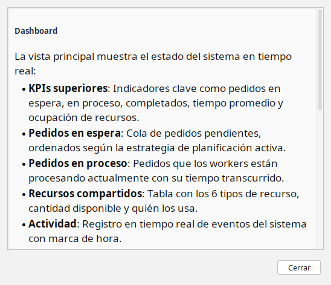
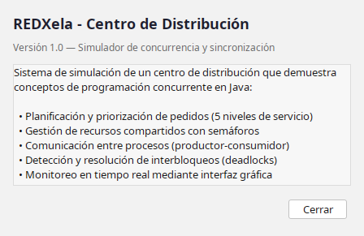
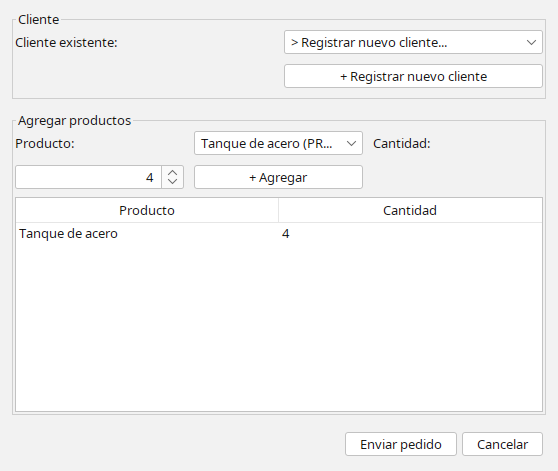
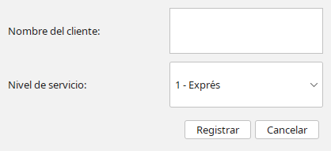
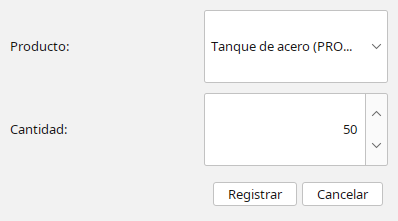

# Manual de Usuario — REDXela

---

> **Universidad de San Carlos de Guatemala**  
> **Centro Universitario de Occidente**  
> **División de Ciencias de la Ingeniería**  
> **Ingeniería en Ciencias y Sistemas**  
> **Sistemas Operativos 2**  
> **Autor:** Juan Casiá  
> **Registro Académico:** 201930457  
> **Versión:** 1.0  
> **Fecha:** Octubre 2026  

---

**Centro de Distribución — Simulación en Tiempo Real**

---

## 1. Introducción

REDXela es un sistema que simula el funcionamiento interno de un centro de distribución de comercio electrónico. Permite observar en tiempo real cómo se reciben, planifican, procesan y despachan pedidos compitiendo por recursos limitados como estaciones de empaque, montacargas, áreas de carga y personal.

Este manual explica cómo utilizar la interfaz gráfica del sistema para monitorear la operación, ingresar pedidos manualmente, registrar mercadería y resolver conflictos de recursos.

---

## 2. Inicio del Sistema

Para ejecutar REDXela, se requiere **Java 21 o superior** instalado en el equipo.

### 2.1. Ejecución desde el JAR

1. Navegar a la carpeta `target/` del proyecto.
2. Ejecutar el siguiente comando en la terminal:

```bash
java -jar red-xela-1.0-SNAPSHOT.jar
```

3. Se abrirá automáticamente la ventana principal del sistema y en la consola se mostrará la configuración de mercancías y el catálogo de productos cargados.

### 2.2. Qué sucede al iniciar

Al arrancar el sistema, se ejecutan automáticamente los siguientes procesos en segundo plano:

- **Generador de pedidos automáticos**: Crea pedidos cada 2 a 5 segundos con productos reales del catálogo.
- **5 trabajadores (workers)**: Hilos que procesan pedidos concurrentemente, solicitando los recursos necesarios según el tipo de mercancía.
- **Recepción e Inventario**: Dos áreas que se comunican de forma asíncrona para registrar la llegada de mercadería.
- **Almacén**: Se carga con 100 unidades de cada producto del catálogo como stock inicial.

---

## 3. Ventana Principal — Dashboard

La ventana principal muestra el **Dashboard**, un panel con toda la información más importante del sistema visible de un vistazo.


### 3.1. Barra Superior

En la parte superior se muestra el título **REDXela - Centro de Distribución** y un indicador verde **● SIMULANDO** que confirma que el sistema está activo.

### 3.2. Indicadores Clave (KPIs)

Cinco indicadores numéricos muestran el estado general del sistema:

| Indicador | Descripción |
|-----------|-------------|
| **Pedidos en espera** | Cantidad de pedidos esperando ser asignados a un trabajador. |
| **En proceso** | Pedidos que están siendo procesados actualmente por los 5 trabajadores. |
| **Completados** | Total de pedidos que terminaron su procesamiento exitosamente. |
| **Tiempo promedio** | Estimación del tiempo promedio por pedido completado. |
| **Ocupación recursos** | Porcentaje de recursos compartidos que están en uso en este momento. |

### 3.3. Pedidos en Espera

Tabla que muestra los pedidos pendientes de procesamiento, ordenados según la estrategia de planificación activa. Encima de la tabla se indica el criterio de orden actual:

- **Orden: Prioridad estricta** — Los pedidos con nivel de servicio más alto (Exprés) se procesan primero.
- **Orden: Tiempo de espera** — El pedido que llegó primero se procesa primero (FIFO).
- **Orden: Menor cantidad** — Los pedidos con menos artículos se procesan primero.

Cada fila muestra:

| Columna | Descripción |
|---------|-------------|
| **ID** | Identificador único del pedido (ej. PED-0001). |
| **Cliente** | Nombre del cliente que realizó el pedido. |
| **Prioridad** | Nivel de servicio con nombre descriptivo (Exprés, Prioritario, Estándar, Programado, Económico). |
| **Artículos** | Cantidad total de unidades en el pedido. |
| **Estado** | Estado actual del pedido en esta tabla: `CREADO` (recién ingresado) o `EN_ESPERA` (habilitado tras reponer stock). Los pedidos sin stock se apartan en una lista de bloqueados. |
| **Tiempo espera** | Tiempo transcurrido desde que el pedido llegó al sistema. |

### 3.4. Pedidos en Proceso

Tabla que muestra los pedidos actualmente asignados a un trabajador. Cada fila incluye:

| Columna | Descripción |
|---------|-------------|
| **ID** | Identificador del pedido. |
| **Cliente** | Nombre del cliente. |
| **Prioridad** | Nivel de servicio del cliente. |
| **Artículos** | Cantidad de unidades. |
| **Estado** | Estado actual: `PROCESANDO`. |
| **Tiempo transcurrido** | Tiempo desde que el pedido llegó al sistema (incluye la espera previa en cola). |

### 3.5. Recursos Compartidos

Tabla que muestra los 6 tipos de recurso del centro de distribución:

| Recurso | Cantidad Total |
|---------|---------------|
| Estación de Empaque | 6 |
| Área de Carga | 2 |
| Encargado de Bodega | 10 |
| Montacargas | 3 |
| Control de Calidad | 4 |
| Escáner de Códigos | 1 |

Cada fila muestra la cantidad total, disponibles, en uso y los IDs de los pedidos que los utilizan actualmente.

### 3.6. Log de Actividad

Panel en la parte inferior derecha que registra los eventos del sistema en tiempo real con marca de hora (HH:mm:ss):

- **Nuevo pedido**: Cuando un pedido llega al sistema.
- **Inició procesamiento**: Cuando un trabajador comienza a procesar un pedido.
- **Pedido completado**: Cuando un pedido termina su procesamiento.
- **Bloqueado por falta de stock**: Cuando un pedido no puede procesarse porque el almacén no tiene las mercancías necesarias.

---

## 4. Pestaña — Almacén

La segunda pestaña muestra el estado del almacén de mercadería.


### 4.1. Capacidad General

Una barra de progreso muestra el espacio ocupado respecto a la capacidad máxima del almacén (5000 unidades).

### 4.2. Existencias por Producto

Lista que muestra cada producto del catálogo con su nombre, código y cantidad actual en stock. Ejemplo:

```
Libros (PROD-S002): 100 unidades
Motor industrial (PROD-P001): 83 unidades
```

### 4.3. Ubicaciones Físicas

Un grid de 100 cuadrados representa las ubicaciones físicas del almacén:

- **Verde** — Ubicación libre
- **Rojo** — Ubicación ocupada

Las ubicaciones se asignan automáticamente al registrar la llegada de mercadería. Un lote puede ocupar varias ubicaciones que no necesariamente son contiguas, simulando la distribución real en pasillos diferentes.

---

## 5. Menú Global

La barra de menú en la parte superior de la ventana contiene tres menús:

### 5.1. Archivo

| Opción | Atajo | Descripción |
|--------|-------|-------------|
| **Nuevo pedido** | `Ctrl+N` | Abre el diálogo para ingresar un pedido manualmente. |
| **Registrar mercadería** | `Ctrl+M` | Abre el diálogo para registrar la llegada de productos al almacén. |
| **Salir** | `Ctrl+Q` | Cierra la aplicación. |

### 5.2. Sistema

| Opción | Descripción |
|--------|-------------|
| **⏸ Detener generador / ▶ Reanudar generador** | Detiene o reanuda la generación automática de pedidos. Los pedidos existentes continúan procesándose. |
| **Estrategia** | Submenú con tres opciones de planificación (radio buttons): Prioridad estricta, Tiempo de espera, Menor cantidad. El cambio se aplica inmediatamente. |
| **Simular deadlock** | Abre el diálogo para simular y resolver un conflicto de recursos deliberado. |

### 5.3. Ayuda

| Opción | Descripción |
|--------|-------------|
| **Modo de uso** | Abre este manual en formato de diálogo dentro de la aplicación. |
| **Acerca de REDXela** | Muestra información del proyecto, versión y características implementadas. |





---

## 6. Ingresar un Pedido Manualmente

1. Seleccionar **Archivo → Nuevo pedido** (o presionar `Ctrl+N`).
2. Se abre un diálogo con los siguientes campos:



### 6.1. Datos del Cliente

- **Cliente existente**: Seleccionar un cliente registrado desde el menú desplegable. El nivel de servicio se asigna automáticamente según el contrato del cliente.
- **Registrar nuevo cliente**: Presionar el botón `+ Registrar nuevo cliente` para abrir un diálogo donde se ingresa el nombre y se selecciona el nivel de servicio (1 a 5).



### 6.2. Niveles de Servicio

| Nivel | Nombre | Tiempo máximo de espera |
|-------|--------|------------------------|
| 1 | **Exprés** | 1 minuto |
| 2 | **Prioritario** | 10 minutos |
| 3 | **Estándar** | 30 minutos |
| 4 | **Programado** | 60 minutos |
| 5 | **Económico** | 120 minutos |

### 6.3. Productos

1. Seleccionar un producto del catálogo desde el menú desplegable (se muestra nombre y código).
2. Ingresar la cantidad deseada.
3. Presionar `+ Agregar` para añadir el producto a la lista del pedido.
4. Repetir para agregar más productos.
5. La tabla inferior muestra los productos seleccionados antes de enviar.

### 6.4. Enviar

Presionar **Enviar pedido** para agregar el pedido a la cola del sistema. El pedido aparecerá inmediatamente en la tabla "Pedidos en espera" del Dashboard.

---

## 7. Registrar Llegada de Mercadería

1. Seleccionar **Archivo → Registrar mercadería** (o presionar `Ctrl+M`).
2. Se abre un diálogo con:
   - **Producto**: Menú desplegable con todos los productos del catálogo (nombre y código).
   - **Cantidad**: Campo numérico para indicar las unidades que llegan.
3. Presionar **Registrar** para actualizar el stock del almacén.
4. Las ubicaciones físicas se asignan automáticamente y se reflejan en la pestaña Almacén.



Cuando se registra mercadería, los pedidos que estaban **bloqueados** por falta de stock pueden reanudarse automáticamente si ahora hay suficiente inventario.

---

## 8. Simulación y Resolución de Deadlocks

Un **deadlock** (interbloqueo) ocurre cuando dos operaciones necesitan los mismos dos recursos en orden inverso, quedando ambas bloqueadas indefinidamente.

### 8.1. Cómo Simular un Deadlock

1. Seleccionar **Sistema → Simular deadlock**.
2. Se abre una ventana que muestra el estado de dos operaciones en conflicto:
   - **Operación 1**: Solicita primero Montacargas, luego Escáner de Códigos.
   - **Operación 2**: Solicita primero Escáner de Códigos, luego Montacargas.


### 8.2. Estados del Conflicto

El diálogo muestra el estado en tiempo real:

| Estado | Color | Significado |
|--------|-------|-------------|
| **Iniciando** | Amarillo | La operación comienza la simulación y solicita su primer recurso. |
| **Adquirió recurso** | Azul / Morado | La operación retiene un recurso y espera el segundo. |
| **Bloqueada** | Rojo | La operación espera un recurso que retiene la otra operación. |
| **⚠ INTERBLOQUEO** | Rojo | Ambas operaciones están bloqueadas mutuamente. |
| **Completada / Interrumpida** | Verde / Rojo | Estado final tras resolver el conflicto manualmente. |

### 8.3. Resolver el Conflicto

Cuando se detecta el deadlock, se habilitan dos botones:

- **Continuar Operación 1**: La Operación 1 obtiene los recursos disputados y la Operación 2 regresa a la cola de espera.
- **Continuar Operación 2**: La Operación 2 obtiene los recursos disputados y la Operación 1 regresa a la cola de espera.

Al presionar un botón, se libera la operación seleccionada y la otra se interrumpe, rompiendo el ciclo de bloqueo.


---

## 9. Cambio de Estrategia de Planificación

El sistema permite cambiar la estrategia de planificación en tiempo real desde **Sistema → Estrategia**:

### 9.1. Prioridad Estricta

Los pedidos se ordenan por nivel de servicio del cliente. Un pedido Exprés (nivel 1) siempre se procesa antes que uno Económico (nivel 5), independientemente de cuándo llegó.

### 9.2. Tiempo de Espera (FIFO)

Los pedidos se procesan en el orden en que llegaron al sistema. El primero en llegar es el primero en ser atendido, sin considerar el nivel de servicio.

### 9.3. Menor Cantidad de Artículos

Los pedidos con menos unidades se procesan primero, independientemente del nivel de servicio o tiempo de espera. Esto optimiza el throughput del sistema.

---

## 10. Tipos de Mercancía

Cada producto pertenece a un tipo de mercancía que determina qué recursos necesita para su procesamiento:

| Tipo | Descripción | Recursos requeridos |
|------|-------------|-------------------|
| **Frágil** | Productos que requieren manipulación delicada | Estación de Empaque, Encargado de Bodega, Control de Calidad |
| **Pesado** | Productos de gran peso o volumen | Montacargas, Área de Carga, Encargado de Bodega |
| **Peligroso** | Materiales que requieren registro especial | Escáner de Códigos, Encargado de Bodega, Área de Carga |
| **Perecedero** | Productos con vida útil limitada | Control de Calidad, Escáner de Códigos, Encargado de Bodega |
| **Estándar** | Productos sin requisitos especiales | Estación de Empaque, Encargado de Bodega |

---

## 11. Catálogo de Productos

El sistema incluye 15 productos predefinidos (3 por tipo de mercancía):

| Código | Nombre | Tipo |
|--------|--------|------|
| PROD-F001 | Vaso de cristal | Frágil |
| PROD-F002 | Espejo decorativo | Frágil |
| PROD-F003 | Lámpara de vidrio | Frágil |
| PROD-P001 | Motor industrial | Pesado |
| PROD-P002 | Tanque de acero | Pesado |
| PROD-P003 | Compresor de aire | Pesado |
| PROD-L001 | Ácido sulfúrico | Peligroso |
| PROD-L002 | Pintura inflamable | Peligroso |
| PROD-L003 | Gas propano | Peligroso |
| PROD-E001 | Leche fresca | Perecedero |
| PROD-E002 | Frutas importadas | Perecedero |
| PROD-E003 | Carnes congeladas | Perecedero |
| PROD-S001 | Ropa de vestir | Estándar |
| PROD-S002 | Libros | Estándar |
| PROD-S003 | Juguetes | Estándar |

---

## 12. Preguntas Frecuentes

### ¿Qué significa que un pedido quede "Bloqueado"?

Un pedido se bloquea cuando el almacén no tiene suficiente stock de los productos solicitados. Se aparta de la cola principal y se registra en el log de actividad. Al registrar la llegada de la mercadería faltante, el pedido se reincorpora automáticamente a la cola de espera.

### ¿Qué pasa si detengo el generador de pedidos?

Los pedidos existentes en la cola continúan procesándose normalmente. Solo se detiene la creación de nuevos pedidos automáticos. Se puede reanudar en cualquier momento desde el menú Sistema.

### ¿Cuántos pedidos pueden procesarse simultáneamente?

Máximo 5, ya que el sistema tiene 5 trabajadores (workers) activos. Los demás esperan en la cola según la estrategia de planificación.

### ¿Cómo sé qué estrategia de planificación está activa?

Encima de la tabla "Pedidos en espera" en el Dashboard se muestra una etiqueta con el criterio de orden actual (ej. "Orden: Prioridad estricta").
